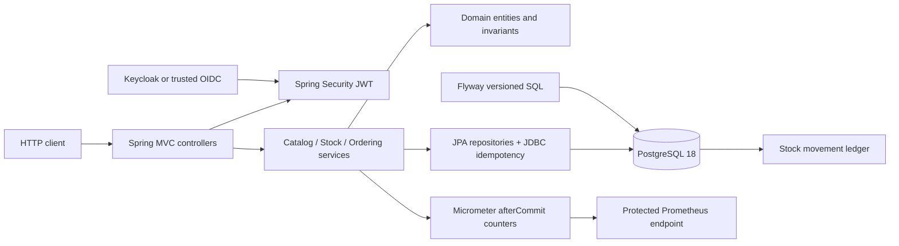
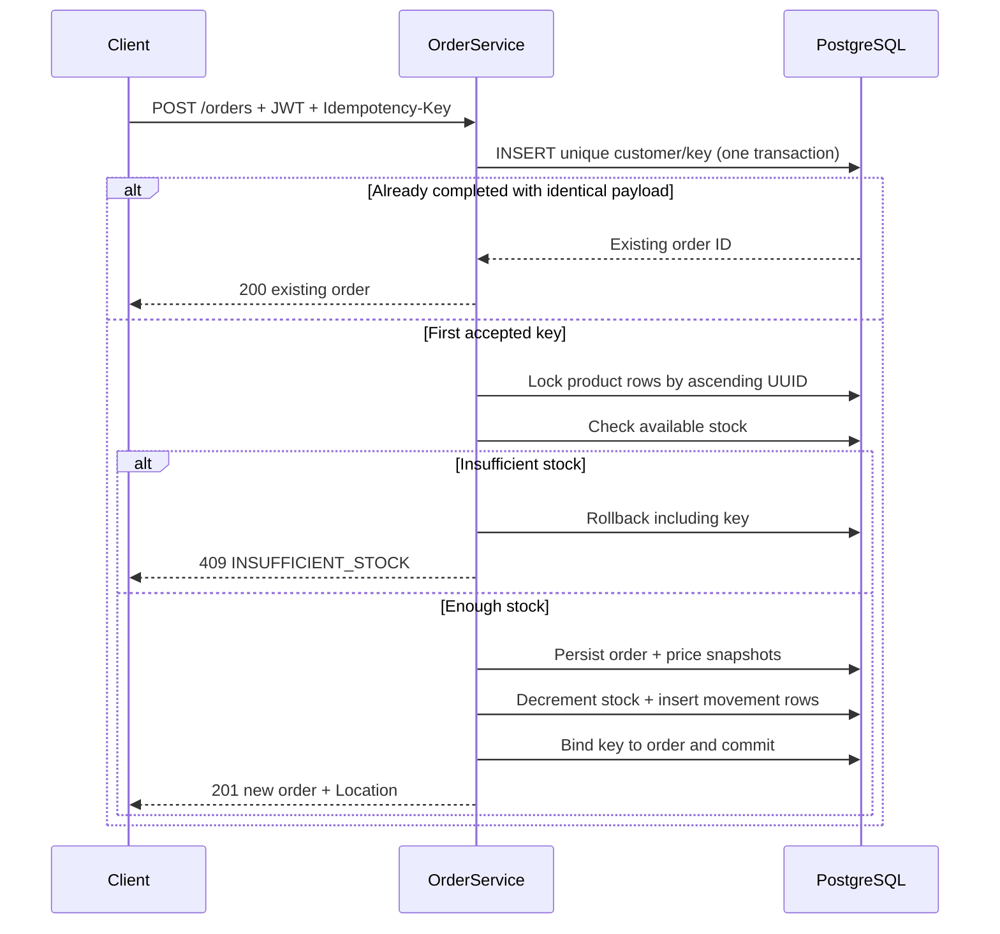

# OrderFlow architecture

## Why a modular monolith?

Stock consumption, checkout and cancellation must share one transaction boundary and one authoritative PostgreSQL state. A modular monolith allows us to demonstrate reliable state transitions and database concurrency without introducing network partitions or distributed sagas simply to showcase infrastructure.

The diagram is a conceptual dependency view. JWT verification happens in the security filter chain before protected controllers run. Flyway applies the schema before Hibernate validates mappings.

## Feature boundaries

| Package | Responsibility | Explicit rule |
| --- | --- | --- |
| `catalog` | Products, SKU normalization, price and editable metadata | Public product queries; ADMIN writes |
| `inventory` | Available quantities and stock movements | Every stock write requires a product row lock |
| `ordering` | Customer orders, snapshots, cancellation and idempotency | Every checkout transaction owns all stock/order/ledger writes |
| `common` | HTTP Problem Details, security, monitoring and pagination | Shared technical facilities, not a dumping ground |

Controllers call application services; they do not directly call persistence adapters. Domain classes are independent from Spring MVC, persistence adapters and application orchestration. ArchUnit enforces key boundary rules.

## Checkout: state and concurrency

The exact implementation uses PostgreSQL product-row pessimistic locks, ordered by UUID, and a unique `(customer_subject, idempotency_key)` constraint. A cancellation locks the order and then the relevant products before restoring stock once.

Administrative product edits instead use **optimistic** locking: Flyway creates the version column; `@Version` checks writes; strong `ETag`/`If-Match` maps stale clients to HTTP 412.

## Operational boundary

The API container runs as a non-root user. Runtime secrets and OIDC settings come from environment variables. Health probes are public, while Prometheus metrics require an ADMIN JWT in the local demo. Logs are ECS JSON with validated request IDs and no request payload/token logging.

The Compose Keycloak realm deliberately includes demonstration passwords and permits password grants for local testing; it is not production identity infrastructure.

## Evidence and limits

- `docs/adr/` contains architecture trade-offs and the reasons behind each design.
- PostgreSQL Testcontainers tests exercise migrations, CHECK constraints, rollback, lock racing and permission boundaries.
- CI includes real OIDC tokens, k6 bounded workload summaries and an isolated SQL restore drill.
- `docs/portfolio-case-study.md` is the reviewer-oriented narrative, not a claim of production certification.

See [engineering-review.md](engineering-review.md) for unresolved issues such as legacy V5 ownership migration, idempotency retention policy, rate limits and real off-host disaster recovery.
